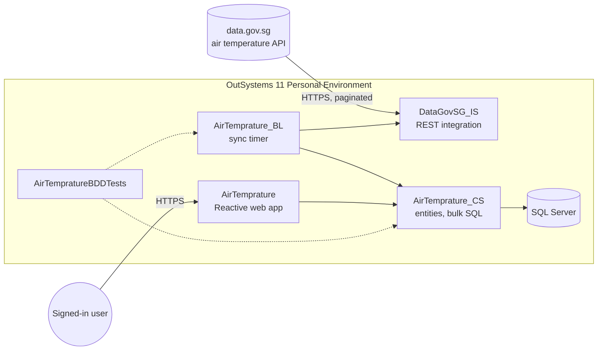

# SG Air Temperature Explorer

An OutSystems 11 app that pulls Singapore's real-time air temperature readings from
data.gov.sg and lets you explore them. NEA publishes one reading per station every minute.
The app syncs them every 5 minutes and shows a live island overview, a colour-coded map of
the stations, a ranking from hottest to coolest, and each station's history over a day,
7 days or 30 days.

The application itself lives in OutSystems. This repository holds the rest: the exported
OutSystems solution, the Terraform for AWS hosting, the automated tests and the documentation.

## Live app

URL: https://personal-qjaqfoeg.outsystemscloud.com/AirTemprature

It runs in an OutSystems Personal Environment, and every screen needs a login.

To get access:

1. Ask me for an account. App users are managed in the environment's Users application
   (https://personal-qjaqfoeg.outsystemscloud.com/Users).
2. Sign in at the app URL.
3. The Sync History screen also needs the `SyncMonitor` role, which I can grant in the Users
   app (Users > user > Roles).

What's in the app:

| Screen | Access | Content |
|---|---|---|
| Dashboard | Any signed-in user | Island average, hottest and coolest station, spread, stations reporting, the station map (click a station for details), the ranking, and today's temperature by hour |
| Station Detail | Any signed-in user | Latest reading and rank, min / average / max, data coverage, and a chart by hour or by day |
| Sync History | `SyncMonitor` role | Last successful sync, runs and success rate over 24 hours, rows inserted per run, recent runs and errors |

Times on screen are Singapore time. The database stores UTC.

Personal Environments are free sandboxes, so the first page load can be slow, and OutSystems
may reset the environment after a long period without use.

## Architecture



The modules follow the OutSystems 4-layer canvas, and dependencies only point downwards:

- **DataGovSG_IS** wraps the data.gov.sg API: date and pagination parameters, the optional
  API key header, and the response structures.
- **AirTemprature_CS** owns the data (`WeatherStation`, `TempratureReading`, `SyncRun`) and
  exposes the bulk insert actions and the sync checkpoint.
- **AirTemprature_BL** runs the sync. A timer fires every 5 minutes and works through each
  Singapore day from the newest stored reading up to today. It reads pages newest first,
  stops once it reaches data it already has, and inserts each page in a single SQL
  statement. Inserts are idempotent, so a page can be fetched twice without creating
  duplicates. A run stops on its own after 15 minutes. The small decisions inside the sync
  are separate functions so they can be unit tested.
- **AirTemprature** is the Reactive UI. All data is read on the server, and Singapore-time
  labels are formatted there too, so they are correct whatever time zone the viewer is in.
- **AirTempratureBDDTests** holds the BDDFramework tests for the CS and BL modules.

A few numbers: 18 stations × 1,440 minutes is about 26,000 readings a day. In normal
operation each sync run needs a single API call and adds around 90 rows. The optional
data.gov.sg API key is a Site Property set in Service Center and is never committed here.

More detail is in [docs/architecture.md](docs/architecture.md), and the reasoning behind the
main choices is in [docs/decisions.md](docs/decisions.md).

## What's in this repo

```
.
├── outsystems/                 Exported OutSystems solution (.osp) and the theme stylesheet
├── infra/                      Terraform for a single-server AWS proof of concept
├── tests/AirTemperature.Tests/ .NET 10 tests (NUnit + Playwright)
│   ├── Api/                    Contract tests for the data.gov.sg API
│   └── E2E/                    UI tests against the live app
├── docs/                       Architecture, decisions, testing
└── .github/workflows/          CI for the Terraform checks, secret scan and tests
```

- [docs/architecture.md](docs/architecture.md): modules, data model, the sync, time zones, security
- [docs/decisions.md](docs/decisions.md): why the dataset, and the trade-offs I made
- [docs/testing.md](docs/testing.md): BDD tests in OutSystems, automated tests, CI
- [docs/future-recommendations.md](docs/future-recommendations.md): what I would build next
- [infra/README.md](infra/README.md): the AWS setup

## Development

### The OutSystems app

You need Service Studio 11 and an OutSystems environment (a free Personal Environment is enough).

1. Either connect Service Studio to the running environment, or restore the app from this
   repo: Service Center > Factory > Solutions > upload the `.osp` from `outsystems/` > Publish.
2. When dependencies change, publish in this order: `DataGovSG_IS`, `AirTemprature_CS`,
   `AirTemprature_BL`, `AirTemprature`, `AirTempratureBDDTests`. Refresh the dependencies in
   each consumer after publishing the module it depends on.
3. Configuration in Service Center:
   - `DataGovSG_IS` > Site Property `ApiKey`: your data.gov.sg key (optional; empty uses the anonymous rate limit).
   - `AirTemprature_BL` > timer `AirTempratureSyncScheduledScheduled`: every 5 minutes.
4. Styles: the shared CSS is in the AirTemprature theme. Edit
   `outsystems/AirTemprature-theme.css` first and paste it into the theme, so this repo stays
   the source of truth.
5. Before publishing, open the `CS_Tests` and `BL_Tests` screens of `AirTempratureBDDTests`
   and check that everything is green.

### Tests in this repo

You need the .NET 10 SDK.

```powershell
cd tests\AirTemperature.Tests
dotnet test
```

The API tests need nothing else. The UI tests install Chromium themselves the first time,
and read the login from environment variables for the current shell. Without them, the
logged-in tests are skipped:

```powershell
$env:APP_USERNAME = "<app user>"; $env:APP_PASSWORD = "<password>"; dotnet test
```

See [docs/testing.md](docs/testing.md) for the details.

### Terraform

You need Terraform 1.9 or later. The checks don't need an AWS account:

```bash
cd infra
terraform init -backend=false
terraform validate
```

## Contributing

- Branch from `main` (`feature/...` or `fix/...`) and open a pull request.
- For changes in OutSystems, publish to the development environment, run the BDD test
  screens, and export the updated solution (`.osp`) into `outsystems/` in the same pull
  request, so the repo always matches what is deployed. If you changed the theme, update
  `outsystems/AirTemprature-theme.css` as well.
- CI has to pass: Terraform fmt and validate, tflint, Checkov, gitleaks and the API tests.
- Never commit secrets: no API keys, passwords or real `.tfvars` files. Use Site Properties
  in OutSystems, environment variables locally and repository secrets in CI.
- In the pull request, explain the problem, the change and how you tested it. If you change
  logic in CS or BL, add or update a BDD scenario.

## Stakeholders

| Role | Who | Interest |
|---|---|---|
| Developer and maintainer | Akhtar Zaman | Builds and runs the app, sync, tests and infrastructure |
| Reviewers | Technical assessment panel | Quality of the solution, engineering practices, decisions and trade-offs |
| Data provider | National Environment Agency, via data.gov.sg | Source of the readings; their API terms and rate limits apply |
| End users | Signed-in users | Current, easy-to-read temperatures by station and over time |
| Operators | Users with the `SyncMonitor` role | Knowing the sync is healthy, and where to look when data seems stale |

## Data source

Air temperature data from the National Environment Agency, through data.gov.sg:
`GET https://api-open.data.gov.sg/v2/real-time/api/air-temperature`.
Used under the [Singapore Open Data Licence](https://data.gov.sg/open-data-licence).
