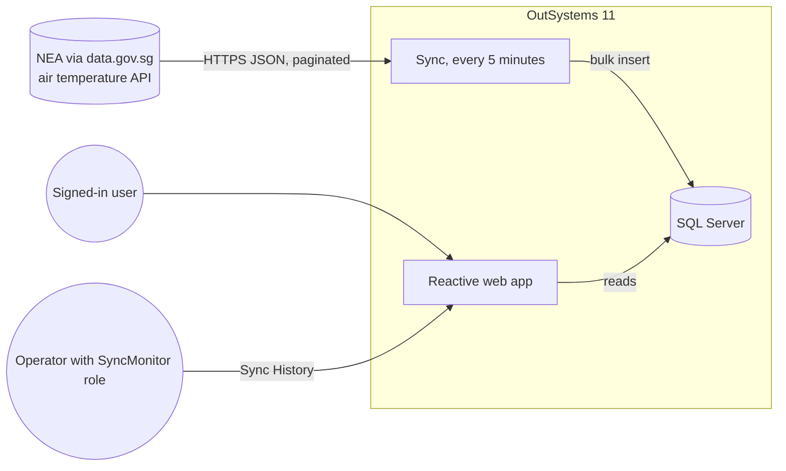
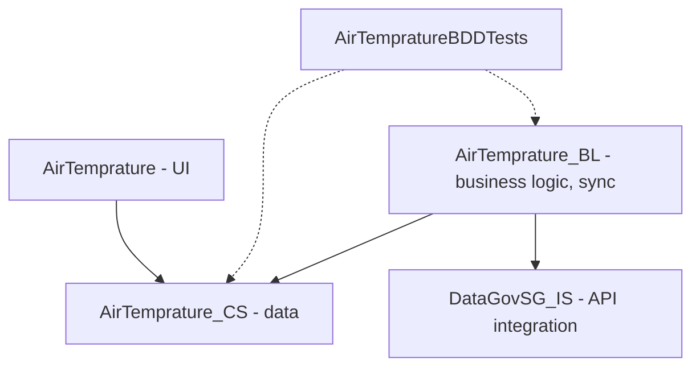
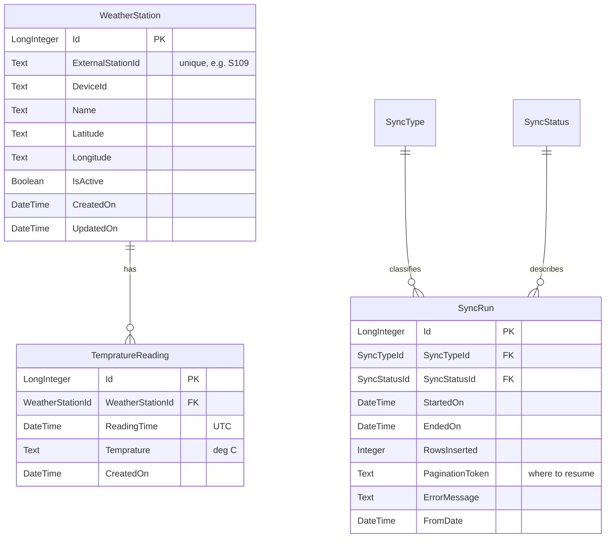
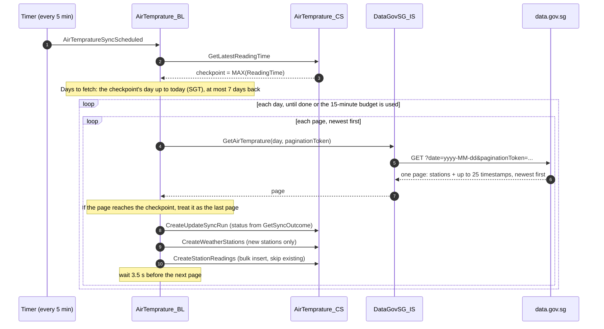

# Architecture

This page explains how the app is put together and how a temperature reading gets from
data.gov.sg onto the screen. The reasons behind the main choices are in [decisions.md](decisions.md).

## Overview

The app keeps its own copy of the readings. The screens never call the API: they read from
the database, which keeps them fast and means only the sync uses up the API's rate limit.

## Modules

I used the OutSystems 4-layer canvas. Each module only depends on the ones below it.

**DataGovSG_IS** consumes the REST API. Its public action `GetAirTemprature` takes a date and
an optional pagination token and returns one page of readings. It adds the API key header
when the `ApiKey` Site Property is set.

**AirTemprature_CS** owns the entities and the SQL. It exposes `CreateWeatherStations` and
`CreateStationReadings` (bulk, idempotent inserts), `GetLatestReadingTime` (the sync
checkpoint) and `CreateUpdateSyncRun`. The entities are exposed read-only to other modules.

**AirTemprature_BL** runs the sync on a timer. The decisions inside it are small public
functions: `GetSyncOutcome`, `IsTimeBudgetExceeded` and `GetResumeStoredMax`.

**AirTemprature** is the UI: Dashboard, Station Detail and Sync History. It reads data in
server-side data actions and never writes anything.

**AirTempratureBDDTests** contains the `CS_Tests` and `BL_Tests` screens.

## Data model

`TempratureReading` has a unique index on `(WeatherStationId, ReadingTime)`, so a station can
only have one reading per minute, and the inserts rely on it to skip duplicates. A second
index on `ReadingTime` keeps the checkpoint query (`MAX(ReadingTime)`) and the date-range
queries fast.

`SyncType` (InitialLoad, Incremental, Manual) and `SyncStatus` (Running, Succeeded,
PartiallySucceeded, Failed) are static entities.

With 18 stations reporting every minute, the table grows by about 26,000 rows a day, roughly
9.5 million a year.

Two things I would change with more time: temperature and coordinates are stored as Text,
and "Temprature" is misspelled in the entity names. I left the spelling to avoid a data migration.

## The sync

How it behaves:

- **It always moves forward.** Each run starts from the day of the newest stored reading and
  goes up to today, so it catches up after downtime and moves on to new days. (The first
  version kept asking for the checkpoint's own day and got stuck on it. See decision D6.)
- **It doesn't fetch more than it needs.** The API returns readings newest first, so once a
  page reaches the checkpoint, the older pages can't contain anything new and the run stops
  paging. In normal operation a run makes one request and inserts about 90 rows (around 5
  new timestamps × 18 stations).
- **Re-running is safe.** `CreateStationReadings` inserts with `NOT EXISTS`, backed by the
  unique index, so fetching the same page twice never creates duplicates.
- **One SQL statement per page.** The page is serialised to JSON and unpacked in SQL Server
  with `OPENJSON`. Readings are joined to their station by `ExternalStationId`, and
  timestamps are converted to UTC with `SWITCHOFFSET`.
- **Runs are time-boxed.** `IsTimeBudgetExceeded` stops a run after 15 minutes, before the
  timer's 20-minute timeout. The next run picks up from the new checkpoint.
- **Each page is committed.** If something fails, at most one page is lost, and the next run fetches it again.
- **Every run is recorded.** There is one `SyncRun` per day processed, with its status,
  start and end times, and the number of rows inserted. Sync History shows them.

There is also a second timer, `AirTempratureSync`, for manual runs. It resumes a `Manual`
sync run from its stored pagination token and is started by `WakeManualSyncTimer`. Nothing in
the UI triggers it yet.

### Rate limits

The API allows 6 requests per 10 seconds without a key, and 12 or more with one.

The sync waits 3.5 seconds between pages, so with the request time it makes at most one call
every 4 seconds or so, about 2.5 per 10 seconds. That leaves plenty of headroom.

Two numbers are easy to mix up here. The API returns up to 25 timestamps per page; that's its
page size. A normal run, 5 minutes after the previous one, only has about 5 new timestamps,
so it reads the first page, finds the rest already stored and stops. That's one call per run.

The page size only matters when catching up. A full day is 1,440 timestamps, so 58 pages,
which takes around 4 minutes. One 15-minute run can catch up roughly three days, so a week
of downtime clears in about three runs. Users never call the API, so heavy use of the app
can't push the sync over the limit.

## Time zones

- The API sends Singapore time (`+08:00`).
- `ReadingTime` is stored in UTC; the insert does the conversion.
- Hourly and daily groupings are done in SQL with `DATEADD(hour, 8, ReadingTime)`, so they
  follow Singapore days and hours.
- Any time shown as text on a screen is formatted on the server.

The last point matters more than it looks. A Reactive app converts every DateTime it sends to
the browser into the viewer's own time zone. My first version added 8 hours on top of that,
so anyone outside UTC saw the wrong time. I caught it when the dashboard showed readings 5
hours in the future from a UTC+5 browser.

## User interface

**Dashboard.** One server call, `GetDashboardData`, returns everything: the latest reading
per station (SQL, hottest first, stations that have gone quiet listed last), the island
figures, the map circles and today's hourly profile. On screen there is a summary banner
that turns to "Stale" if the newest reading is over 30 minutes old, KPI cards, a Leaflet map
where clicking a station opens a small card, a searchable ranking, and the hourly chart.

**Station Detail.** `GetStationView` returns the station's rank among all stations (SQL
`RANK()`) and min / average / max buckets, by hour for one day or by day for 7 or 30 days.
It also shows data coverage, meaning how many of the expected one-minute readings were actually received.

**Sync History.** `GetSyncHistory` returns the latest 50 runs, the last 24 hours' totals and
rows inserted per run.

The temperature colour scale comes from one server function, `GetTemperatureColor`, used for
the KPI cards, ranking badges and map circles. The shared CSS is in the theme (the source is
[`outsystems/AirTemprature-theme.css`](../outsystems/AirTemprature-theme.css)); only the
Dashboard has a few screen-specific rules for the map. Charts come from OutSystems Charts,
and the map from the LeafletJS Forge component with OpenStreetMap tiles.

## Security

- Every screen needs a login. Users are OutSystems end users, managed in the Users app.
- Sync History also needs the `SyncMonitor` role. OutSystems checks the role on the screen
  itself, so hiding the menu link isn't the only protection.
- Only the sync writes data. The UI only reads, and the CS entities are exposed read-only.
  I removed an older public action that could delete all readings.
- The optional data.gov.sg API key is a Site Property, set per environment in Service Center.
  It isn't in the source or in this repository.
- Traffic is HTTPS throughout (OutSystems Cloud and data.gov.sg).
- gitleaks scans the repository on every push, and the tests read credentials only from
  environment variables or CI secrets.

## Testing and hosting

Testing is covered in [testing.md](testing.md): BDD tests inside OutSystems for the CS and BL
modules, API contract and UI tests in .NET, and the Terraform checks.

The app runs in an OutSystems Personal Environment. [`infra/`](../infra/README.md) has a
single-server AWS setup for self-managed OutSystems 11, along with what would need to change for production.

## Known limitations

- Temperature, latitude and longitude are Text columns; SQL uses `TRY_CAST` where it needs numbers.
- The 3.5-second wait and the 15-minute budget are hard-coded rather than Site Properties.
- The sync flow has no exception handler. If a page fails, its run stays in "Running", and
  the next run starts again from the checkpoint.
- Station details are only inserted, never updated, so a renamed or moved station keeps its
  original name and position.
- Map circles have no hover tooltip. The LeafletJS component writes marker names and icons
  straight into its JavaScript, which broke custom icons, so I used a click-to-open card instead.
- SQL Server Express (in the AWS setup) caps each database at 10 GB, which is still years of
  data at the current volume.
