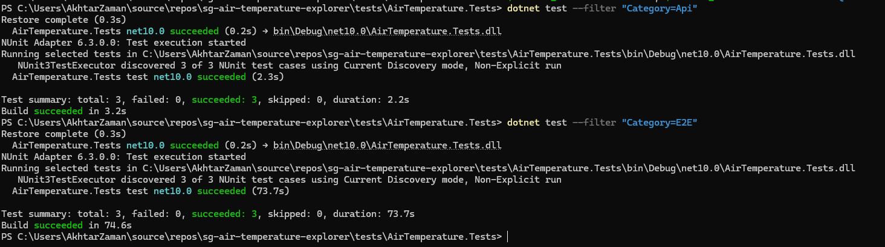
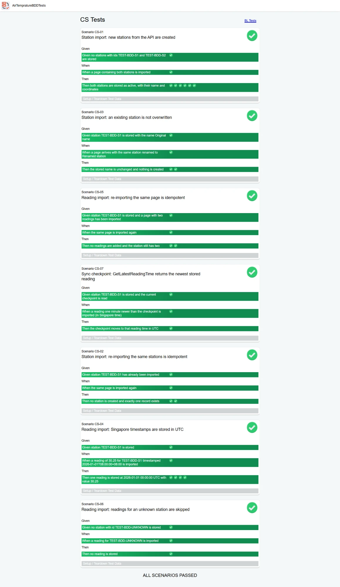
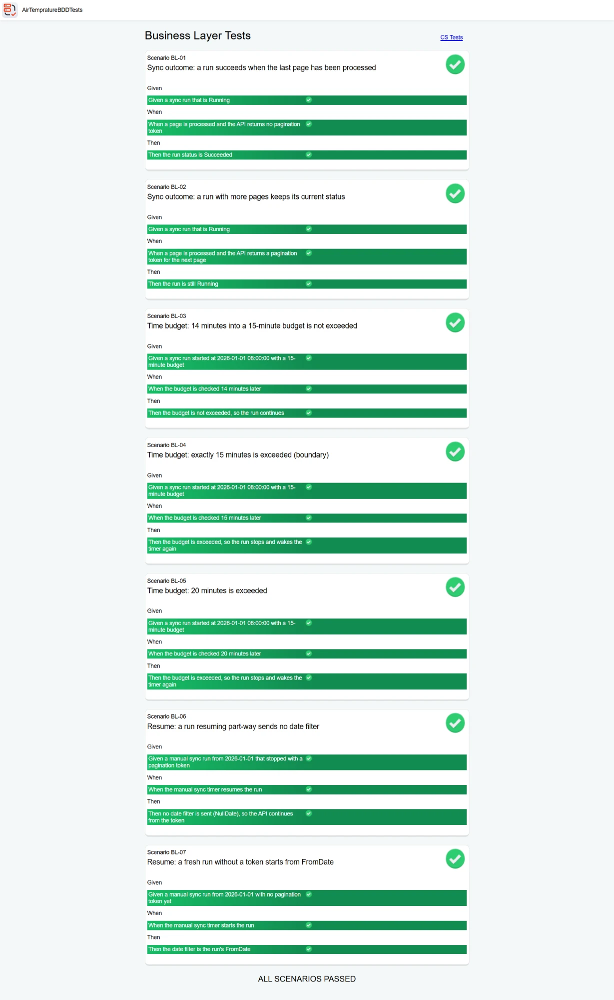

# Testing

Each part of the solution is tested where it makes most sense. The business logic is tested
inside OutSystems. The contract with data.gov.sg and the main user journey are tested from
outside, in CI. The Terraform is checked on every push.

## Overview

| What | Tool | Tests | Runs | Last result (21 Oct 2026) |
|---|---|---|---|---|
| Data layer (CS) | BDDFramework | 7 scenarios | OutSystems, `CS_Tests` screen | 7/7 passed |
| Sync logic (BL) | BDDFramework | 7 scenarios | OutSystems, `BL_Tests` screen | 7/7 passed |
| data.gov.sg API contract | .NET 10, NUnit, Playwright | 3 tests | CI on every push and PR, and nightly | 3/3 passed |
| UI, end to end | .NET 10, NUnit, Playwright (Chromium) | 3 tests | CI nightly and on demand | 3/3 passed |
| Terraform | fmt, validate, tflint, Checkov | static checks | CI on every push and PR | clean (Checkov: 27 passed, 1 skipped with a reason) |
| Secrets | gitleaks | whole git history | CI on every push and PR | no leaks |

I kept the suite small on purpose. It covers what is most likely to break: duplicate-free
inserts, time zones, the sync's decisions, the shape of the API response, and logging in and
moving around the app.

### Evidence

The .NET tests, API contract 3/3 and UI 3/3:



<details>
<summary>BDD tests in OutSystems: CS_Tests, 7/7 passed</summary>



</details>

<details>
<summary>BDD tests in OutSystems: BL_Tests, 7/7 passed</summary>



</details>

The screenshots are from one run. The GitHub Actions runs, with their TRX result files, are the ongoing record.

---

## BDD tests in OutSystems

The tests live in the `AirTempratureBDDTests` module (Traditional Web) and use the
BDDFramework component from the Forge. Each scenario is a web block with Given, When and Then
steps. The checks use `AssertTrue` and `AssertValue`, so a failure shows the expected and
actual values.

To run them, publish the module and open its two screens in a browser:
`https://<environment>/AirTempratureBDDTests/CS_Tests` and `.../BL_Tests`. Each page ends
with "ALL SCENARIOS PASSED" or lists what failed.

### CS_Tests (data layer, 7 scenarios)

These call the real CS actions against the real database, so they must not leave any data behind:

- every scenario's teardown calls `AbortTransaction`, which rolls back what it inserted;
- a block placed after all the scenarios calls `AbortTransaction` again, in case a failing
  step stopped a scenario before its teardown ran;
- test stations use IDs starting with `TEST-BDD-`, which can't clash with NEA's real station IDs.

None of them call data.gov.sg. The input is fixed JSON in the same shape the BL module
produces, so the results don't change from run to run and don't use the API's rate limit.

| ID | Scenario | In short | Action tested |
|---|---|---|---|
| CS-01 | New stations from the API are created | Two `TEST-BDD` stations that don't exist yet are imported; both are stored as active with the right name and coordinates | `CreateWeatherStations` |
| CS-02 | Importing the same stations again creates nothing | A station is imported twice; nothing new is created and there is exactly one record | `CreateWeatherStations` |
| CS-03 | An existing station isn't overwritten | A station stored as "Original name" arrives as "Renamed station"; the stored name stays the same (stations are insert-only) | `CreateWeatherStations` |
| CS-04 | Singapore timestamps are stored in UTC | A reading of 30.25 at `2026-01-01T08:00:00+08:00` is stored once, at `2026-01-01 00:00:00` UTC, with value 30.25 | `CreateStationReadings` |
| CS-05 | Importing the same page again adds nothing | A page with two readings is imported twice; the station still has two readings | `CreateStationReadings` |
| CS-06 | Readings for an unknown station are skipped | A reading for `TEST-BDD-UNKNOWN`, which doesn't exist, is ignored without an error | `CreateStationReadings` |
| CS-07 | The checkpoint returns the newest reading | After a reading one minute newer than the current checkpoint is imported, the checkpoint moves to that time (in UTC) | `GetLatestReadingTime` |

### BL_Tests (sync logic, 7 scenarios)

The sync itself makes API calls and commits, which can't be tested safely in place. So I
moved its decisions into small functions that don't touch the database or the API, and these
scenarios test those functions directly. They don't need any rollback and run in milliseconds.
`IsTimeBudgetExceeded` takes the current time as a parameter, so the tests use fixed times rather than the clock.

| ID | Scenario | In short | Function tested |
|---|---|---|---|
| BL-01 | A run succeeds after the last page | Running run, page without a pagination token: status becomes Succeeded | `GetSyncOutcome` |
| BL-02 | A run with more pages keeps its status | Running run, page with a next-page token: still Running | `GetSyncOutcome` |
| BL-03 | 14 minutes of a 15-minute budget isn't over | Started 08:00, checked 08:14: carries on | `IsTimeBudgetExceeded` |
| BL-04 | Exactly 15 minutes is over (boundary) | Started 08:00, checked 08:15: stops | `IsTimeBudgetExceeded` |
| BL-05 | 20 minutes is over | Started 08:00, checked 08:20: stops | `IsTimeBudgetExceeded` |
| BL-06 | Resuming part-way sends no date filter | Manual run stopped with a token: no date filter, the API continues from the token | `GetResumeStoredMax` |
| BL-07 | A fresh run starts from its FromDate | Manual run with no token yet: the date filter is the run's FromDate | `GetResumeStoredMax` |

When a run uses up its budget it stops, and the next timer run five minutes later continues
from the new checkpoint.

---

## Automated tests in this repo

The project is `tests/AirTemperature.Tests` (.NET 10, NUnit 4, Microsoft.Playwright.NUnit):

```
tests/AirTemperature.Tests/
├── TestSettings.cs                         settings, read from environment variables
├── Api/AirTemperatureApiContractTests.cs   data.gov.sg contract   (Category "Api")
└── E2E/                                    the app in a browser    (Category "E2E")
    ├── UiSmokeTests.cs
    └── PlaywrightBrowserSetup.cs           installs Chromium before the UI tests
```

### API contract tests

These check the parts of the data.gov.sg response that the OutSystems integration depends on.
They run nightly as well, so if the API changes, a test fails before the sync breaks. The
three tests make four requests in total, under the anonymous limit of 6 per 10 seconds.

- **`Latest_reading_has_the_shape_the_sync_relies_on`**: `code` is 0, `readingUnit` is
  "deg C", every station has `id`, `name` and `location.latitude` / `location.longitude`,
  timestamps are in `+08:00`, and values are numbers. The IS structures and the SQL depend on
  these fields. (The live API uses `location`, while its OpenAPI spec says `labelLocation`.)
- **`Date_query_is_paginated_newest_first`**: asking for yesterday's date (Singapore time)
  returns readings newest first with a pagination token, and page 2 continues with older
  readings. The sync's stop-at-the-checkpoint logic relies on that order.
- **`Invalid_date_is_rejected_with_400`**: an invalid date returns HTTP 400.

### UI tests

These run in Chromium against the deployed app.

- **`Anonymous_visitor_is_sent_to_login`**: opening the Dashboard without signing in redirects to the login screen.
- **`Dashboard_shows_live_island_overview`**: after signing in, the island average, the
  stations-reporting count (for example `18 / 18`) and the ranking are visible.
- **`Station_detail_opens_from_ranking_and_switches_range`**: clicking the top station opens
  Station Detail with its latest reading, and switching to "7 days" shows daily figures.

A few things I learned while writing them:

- The login comes only from environment variables (`APP_USERNAME`, `APP_PASSWORD`). If they
  aren't set, the two signed-in tests are skipped rather than failed.
- When a login fails, Playwright's default error report includes the values typed into the
  form, password included. The test replaces that report with the app's own error message,
  so a password can never end up in CI logs.
- A Reactive app loads its scripts before it shows anything or redirects, which takes about
  10 seconds on a cold Personal Environment. Checks therefore wait up to 20 seconds. Login
  waits for the URL to change rather than for a page load event, because Reactive apps move
  between screens without reloading the page.
- Chromium is installed automatically before the first UI test, and nothing happens if it's
  already there. On CI the system libraries it needs are installed too.

### Running them

You need the .NET 10 SDK. From `tests/AirTemperature.Tests`:

```powershell
dotnet test --filter "Category=Api"
```

For the UI tests, set the login for the current shell (it isn't saved anywhere) and run:

```powershell
$env:APP_USERNAME = "<app user>"; $env:APP_PASSWORD = "<password>"; dotnet test --filter "Category=E2E"
```

`dotnet test` without a filter runs everything. Two optional variables:

- `APP_BASE_URL` points the UI tests at another environment (the default is the Personal Environment).
- `DATAGOV_API_KEY` sends a data.gov.sg key with the API tests, for a higher rate limit.

---

## CI

Two GitHub Actions workflows:

- **`tests.yml`** runs the API tests on every push and pull request to `main`, every night at
  09:00 Singapore time, and on demand. The UI tests run nightly and on demand only, because
  they use the live environment. They need the repository secrets `APP_USERNAME` and
  `APP_PASSWORD` (ideally a dedicated test user) and optionally the variable `APP_BASE_URL`.
- **`iac.yml`** runs Terraform fmt and validate, tflint, Checkov and gitleaks on every push
  and pull request. It doesn't need AWS credentials.

Test results are uploaded as TRX artifacts. Both workflows only have read access to the
repository, and third-party actions are pinned to commit SHAs.

---

## Not covered yet

- An end-to-end test of the sync itself (the page loop, a commit per page, a run that fails
  halfway) against a stubbed API. For now I check it through Sync History, where a healthy
  sync adds about 90 rows every 5 minutes.
- Running the BDDFramework screens from CI and publishing their results.
- Visual regression and accessibility checks (for example axe-core through Playwright).
- Load testing the sync against the API's rate limit.
