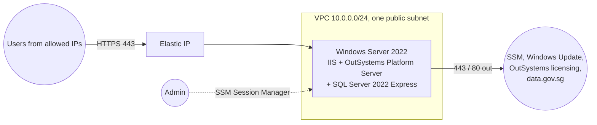

# Infrastructure (AWS proof of concept)

This folder holds the Terraform for hosting a self-managed OutSystems 11 environment on AWS.
It is a proof of concept, so I kept it to the minimum: one Windows server that runs
everything. IIS, OutSystems Platform Server (front-end and Deployment Controller roles) and
SQL Server 2022 Express all live on the same machine.

I haven't applied it, because I didn't have an AWS account for this project, and Platform
Server needs a self-managed OutSystems licence anyway. That is also why the app itself runs
in an OutSystems Personal Environment. The code is checked in CI with `terraform validate`,
tflint and Checkov.

## What gets created



- **VPC with one public subnet**, an internet gateway and a route table. The server needs a
  network and a way out to the internet, nothing more.
- **Security group.** HTTPS in, only from the IP ranges in `allowed_cidrs`. That variable has
  no default, so whoever deploys it has to decide who can connect. Outbound traffic is
  limited to ports 443 and 80. There is no RDP rule.
- **IAM role with `AmazonSSMManagedInstanceCore`.** Admin access goes through SSM Session
  Manager (or Fleet Manager for a remote desktop), so no RDP port and no key pair.
- **EC2 instance** from AWS's *Windows Server 2022 with SQL Server 2022 Express* image. SQL
  Server comes installed and licensed, so I don't need a separate database server.
- **Elastic IP**, so the address (and the DNS name pointing at it) doesn't change when the
  instance restarts.
- The VPC's default security group is emptied so nothing can use AWS's allow-all default by accident.

The instance only allows IMDSv2, has an encrypted gp3 disk and termination protection, and
ignores AMI updates so a newer Windows image never replaces a server that has already been set up.

## Deploying it

```bash
cd infra
cp terraform.tfvars.example terraform.tfvars   # put your own IP in allowed_cidrs
terraform init
terraform plan
terraform apply
```

`terraform output ssm_session_command` prints the command to open a shell on the server.

State is local for now. For anything shared I would move it to an S3 bucket with locking.

## Installing OutSystems on the server

This part is manual because it needs a licence and the Platform Server Configuration Tool.

1. Connect through SSM. For the installer's GUI, Fleet Manager's remote desktop in the AWS
   console works without opening any port.
2. Run the Platform Server 11 installer and let it set up its prerequisites (IIS, .NET).
3. In the Configuration Tool, choose SQL Server and point it at the local instance
   (`localhost\SQLEXPRESS`). It creates the platform, session and logging databases.
4. Upload the licence in Service Center and publish the application.
5. Bind a TLS certificate in IIS for the DNS name that points at the Elastic IP.

## Checks

```bash
terraform fmt -check
terraform init -backend=false
terraform validate
tflint --init && tflint
checkov -d infra --config-file infra/.checkov.yaml
```

Everything passes. Checkov reports 27 passed and 1 skipped. The skip is VPC flow logs, and
the reason is written next to the resource.

## Limits of this setup

I know what this setup leaves out. For a demo environment those gaps are acceptable:

- One server, one availability zone, no load balancer. If the server goes down, the app is down.
- SQL Server Express limits each database to 10 GB. At about 26,000 readings a day that is
  still years of data, but it isn't a production database.
- No backups, alarms or flow logs yet.
- Local Terraform state and a manual install.

If this moved towards production, I would add things in roughly this order: remote state in
S3, scheduled backups (AWS Backup or EBS snapshots), the database moved to RDS SQL Server
Standard (Multi-AZ), an Application Load Balancer with an ACM certificate and WAF, several
front-end servers in an Auto Scaling group, a separate LifeTime environment, and finally
monitoring, alarms and flow logs.
